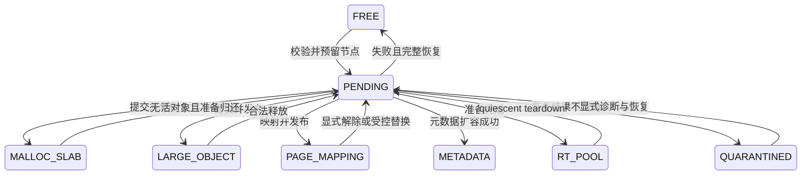

# SuperAlloc 架构设计

本文是待实现的架构契约，不代表已有可运行代码或已测性能。数值基线用于组织首轮实现和验证；更改基线必须同时更新容量核算与测试。项目只提供独立分配函数，不替换进程的 `malloc`、`new` 或系统 `mmap`。

公开函数、状态码和成功点以 [API 契约](api-contracts.md) 为准；本文中的操作名描述内部行为。

## 1. 目标与边界

- 在 Windows、Linux、macOS、Android 上，以一个连续保留地址区间承载对象分配与页级映射；允许操作系统把该区间拆成多个 VMA、VAD 或 view。
- 同一进程可以并发使用多个独立 arena。每个 arena 独立管理范围、backing、元数据、线程上下文、预算和故障。
- 对象分配至少 16B 对齐；页接口以运行时系统页大小 `P` 对齐。64 位容量设计范围为 16MiB 至 4TiB；32 位 Android 的单实例上限为向下按 P 对齐的 `PTRDIFF_MAX`，实际可创建范围受连续虚拟地址和平台限制。
- 支持普通易失、文件驻留、元数据可恢复三类存储行为；普通模式不执行持久日志或 flush。持久边界见 [persistence.md](persistence.md)。
- 支持预配置的受限实时池；实时运行阶段不访问操作系统、不扩充元数据、不进入全局范围锁。一般操作系统上只承诺已审计的算法步骤上界，不承诺调度或硬件的绝对墙钟延迟。
- “领先业界的低延迟高吞吐”是通过可复现对比实验验证的目标，不能由选用某个算法直接推出。

连续保留区不等于全部物理提交，也不等于一个内核 VMA。任意文件映射、保护和回收能力均由平台 capability 与所选 mapping profile 约束，见 [platforms.md](platforms.md)。

## 2. 分层与权威状态

| 层 | 责任 | 不得承担的责任 |
| --- | --- | --- |
| 独立 C ABI | 参数校验、显式 arena/ctx、status 与 out 参数、模式分派 | 隐式全局 heap、隐式全局 errno |
| 对象前端 | size class、线程拥有的 slab、remote free、大对象路径 | 绕过 broker 取得地址 |
| 页映射前端 | 地址提示/固定位置、mapping handle、保护与同步操作 | 覆盖活对象或隐藏能力降级 |
| RT 前端 | 固定 pool、预建索引、有界扫描归还状态 | OS 调用、运行时元数据扩容 |
| ExtentBroker | arena 全域唯一范围所有权、分割合并、Pending 事务 | 在持锁期间执行可能阻塞的 OS 调用 |
| 元数据分配器 | 区域内 descriptor、目录节点、事务工作区 | 调用普通对象分配路径自举 |
| 平台 backend | reserve/commit/decommit/map/unmap/protect/flush 能力 | 单独维护与 broker 冲突的空闲真相 |
| 持久控制层 | 主文件权威账本、日志、恢复、root 发布 | 应用 payload 事务、任意外部多文件原子提交 |

运行中的 `ExtentBroker` 是地址所有权的唯一真相；可恢复模式的持久账本是跨崩溃后的持久分配真相。二者通过持久控制层的提交协议衔接，不能混成一个既包含线程锁又直接写盘的数据结构。

对象热路径只操作已经获得的 slab。普通无 ctx 入口使用 arena 创建时预建的 shared fallback heap 及其锁，不隐式登记线程；ctx 路径使用线程私有 heap。页映射和大对象走 broker 慢路径。普通模式第一版使用单个 arena 内的 broker 锁，先验证正确性及竞争成本；拆分锁不是首版前置条件。不同 arena 不共享 broker 锁。

## 3. 核心不变量

以下编号供设计评审、故障注入和后续测试引用。

| 编号 | 不变量 |
| --- | --- |
| A-01 | arena 的完整逻辑地址范围被不重叠的 extent 分区覆盖，任意字节恰有一个范围所有者。 |
| A-02 | 所有对象 slab、大对象、用户映射、元数据和 RT 池均先从 broker 获得范围；不存在第二个可独立分配相同地址的空闲集合。 |
| A-03 | `FREE` 表示 broker 可以考虑分配该地址，不自动表示已提交、已清零或可直接更换 backing。后端边界和状态必须单独检查。 |
| A-04 | `PENDING`、`METADATA`、`QUARANTINED` 以及其他已占用状态不能出现在可分配空闲索引中。 |
| A-05 | 固定地址操作不能覆盖活 malloc、大对象、元数据、RT 池、别人的映射或正在执行的事务。 |
| A-06 | 发起范围变更前必须取得该变更、完整回滚和故障隔离所需的全部元数据。 |
| A-07 | OS 操作进行时，受影响地址范围保持 `PENDING`；其他分配者不能观察到中间 backing 状态。 |
| A-08 | 无法确认后端恢复结果时，范围进入 `QUARANTINED`，不得把未知状态重新发布为 `FREE`。 |
| A-09 | 活对象地址不因合并、回收或碎片治理而移动。只有调用者显式使用可移动语义的接口才可产生新地址。 |
| A-10 | 线程缓存和空 slab 仍拥有 broker 范围；缓存中的容量不能重复算作全局可立即分配容量。 |
| A-11 | 可增长控制数据均来自所属 arena；元数据分配器不递归调用普通 malloc 前端。 |
| A-12 | 一个 ctx 只绑定一个 arena incarnation 与一个 owner 线程；跨实例不会共享可变分配状态。 |
| A-13 | pool/slab descriptor 的回收晚于最后一个合法对象操作；任何发布释放记录的操作都以发布作为最后一次 descriptor 访问。 |
| A-14 | arena 的关闭/销毁要求调用方保证无并发新进入者；库内部引用计数不能使已解除映射的裸 handle 自动安全。 |
| A-15 | 持久记录只存 offset、长度、身份和版本化字段，不存进程指针、锁、线程身份或 TLS 链。 |
| A-16 | 32 位正确性不依赖 u64 原子始终 lock-free；所有地址与长度换算先检查可表示范围及溢出。 |
| A-17 | 同一进行中范围事务只有一个执行者；超时、线程休眠或诊断观察不赋予其他线程重试OS动作、抢占Pending或释放其pin的权利。 |
| A-18 | 回滚只有在原所有权、backing、保护和要求保留的内容均被证明恢复后才可报告无效果；持久提交确认后不执行相反的逻辑回滚。 |
| A-19 | Quarantined收口后退出active Pending，但既有记录保留全部残留资源责任；Pending名额释放不等于metadata或backing额度可以释放。 |
| A-20 | 重试与维护有明确工作预算和调度条件；安全性不依赖休眠owner醒来，空间重新可用则可能依赖其协作，二者分别验证。 |

A-01描述库的逻辑责任分区；它不把地址账本当作OS所有权证明。后端故障后若局部reservation归属无法确认，该区间只能作为隔离责任保留，禁止盲目固定映射覆盖或整段解除可能已属于他人的地址。其余已证明安全的范围可继续工作；控制元数据损坏、无法界定的越界后端效果不属于合法调用下的局部故障恢复保证。

## 4. 范围账本与地址选择

采用 intrusive、按起始 offset 排序的红黑树作为范围主索引；每个 extent 自带树节点。`FREE` extent 同时挂入按尺寸分级的 intrusive 空闲链表，bitmap 标识非空尺寸档。地址树负责前驱/后继、固定范围校验及相邻合并；尺寸索引用于非固定请求的候选查找。

每个 descriptor 至少表达：范围起点与长度、所有者种类、关联对象/映射身份、后端 view 或 allocation 边界、提交与保护属性、Pending 操作身份，以及各 intrusive 索引链接。字段布局和实际 `sizeof` 在实现阶段验证，不以当前文字估算代替预算。

不同 backing/view 的相邻逻辑空闲范围可以在上层被识别为连续候选，但只有后端允许且相关状态兼容时才能直接合并为一个可供分配的 extent。如果需要先归还 view、合并 placeholder 或恢复 backing，必须通过一次显式 Pending 事务。

地址选择首版采用可配置的放置偏好：对象 span 优先低地址，用户页映射优先高地址；命中现有合适空闲洞优于盲目扩展高低水位。两个方向仅影响候选评分，不形成两个独立的分配器，也不以“两个指针尚未相遇”代替范围所有权验证。

对大连续请求，先检查当前空闲候选，再在配置预算内尝试回收可协作清理的线程缓存和空 slab，最后重试一次。不能强行夺取休眠线程的私有 freelist，不能搬动活对象，也不能因为总空闲较大而报告连续分配成功。普通模式的完整候选搜索可能随碎片数量增长，不归入 RT 延迟承诺。

## 5. 所有权与范围事务

范围状态为 `FREE`、`METADATA`、`MALLOC_SLAB`、`LARGE_OBJECT`、`PAGE_MAPPING`、`RT_POOL`、`PENDING`、`QUARANTINED`。后端提交/保护状态是独立维度；持久 arena 的 `WRITE_FAULTED` 是实例级状态，不替代范围状态。

[状态机规格](state-machines.md)分别定义生命周期、范围事务、对象归还、owner交接与持久提交的转换守卫；[失败与恢复](failure-recovery.md)定义后端效果分类和可重试边界。下面只画范围所有权轴，逻辑退休和cleanup责任不应被误读成已经FREE。

一次事务按下列顺序执行：

1. 在 arena 维护门允许的状态下，检查参数、模式、capability、view profile 和配额；预先计算分割节点、索引节点、操作记录、回滚记录及后端句柄需求。
2. 从专用元数据池取得所有资源。资源不足时尚未变更用户范围，立即返回错误。
3. 获得 broker 锁，重新校验范围与 handle incarnation；把整个受影响范围移出空闲候选或原所有者的可操作集合，建立 `PENDING(op_id)`。保存旧账本状态及恢复目标，释放锁。
4. 在锁外执行后端操作。跨多个 view 的操作记录每一步结果，不假设单次系统调用具有多 view 原子性。
5. 确定成功或完成可行补偿后，保持Pending及pin，在broker锁外完成已预付资源的最终结算，再在broker锁内无失败地发布最终owner、属性和索引，或恢复旧账本/建立隔离范围。发布后不能才补扣新增资源费用，防止其他线程先退休该资源。
6. 只有最终状态可确定后才清理事务资源并按公开操作的成功点返回 status。页操作发生部分后端失败时，返回明确的后端/隔离结果，不伪装为完全无效果的失败；已完成的 VOLATILE 对象逻辑 free 不因随后发生的物理回收错误改报未释放，见第 6.2 节。

对已有映射做替换、保护或部分解除时，仅凭所有权锁不能阻止调用方读写该内存；调用者必须在这些操作期间停用受影响指针。系统调用失败后的原有内容是否保留由该操作的明示契约决定，尤其不能承诺被解除的匿名内容可由重新保留自动恢复。具有破坏性的替换在全部预检后执行；后端无法保证恢复原内容时，不提供强原子替换承诺。

首版不提供覆盖任意 owner 的裸 `MAP_FIXED` 行为。固定地址请求默认 no-replace；替换仅针对调用方持有的现存 mapping handle，且须满足该 profile 的范围边界。API 不因为 Linux 能执行破坏性替换，就在其他平台模拟覆盖活对象。

### 5.1 锁边界与慢路径交接

首版通过禁止不必要的嵌套控制锁序，而不是让全部子系统共同持有一把长锁：

- 生命周期锁只用于状态切换和登记控制；不持有它执行普通分配、backend 或 journal 操作。调用方 quiescence 仍是销毁前提。
- central ownership/shared heap 锁与 broker 锁禁止嵌套。补充 span 时先独立从 broker 取得并初始化，再进入 heap 锁发布；若并发调用取得多余 span，按预算缓存或独立归还。
- slab 退休先在相应 owner/control 保护下摘除并固定退休身份，解除该保护后进入 broker 归还；需恢复 owner 状态时重新取得原控制锁。期间不能让 adopter 重新领取同一退休 slab。
- 普通 metadata pool 锁是叶子锁，不与 broker、heap 或 central 锁嵌套。需要的节点预取到事务私有储备，再进入 broker；发布后剩余节点在锁外归还。
- metadata-growth gate 可以跨越自身扩容事务，并短暂取得 broker 锁执行 Pending 标记与发布；不得因此取得 heap/central 锁。OS 调用期间不持 broker，但 growth gate 可以继续串行化这次扩容。
- journal 提交与 I/O 不持 broker/heap/central 锁。先预取元数据，再取得实例 journal gate，允许 gate 内短暂取 broker 锁登记 Pending 或发布；禁止 broker/heap 锁内反向等待 gate。预占 runtime 范围后提交持久记录，最后更新 runtime。该顺序也串行化 root_set 与 pfree 的引用检查，journal 的串行化只约束该持久实例。
- 不在同一操作内嵌套两个 arena 的锁；跨 arena 对象移动由调用方执行分配、拷贝、释放序列，不提供隐式多 arena 原子事务。

临时退休标记、Pending 和 descriptor pin 负责跨越解锁区间；锁外交接不意味着把原有范围短暂发布为空闲。

## 6. 建立与释放路径

### 6.1 对象分配

- `malloc(0)` 返回 `OK + NULL`；`calloc` 先检查乘法溢出。对象有效负载至少 16B 对齐。
- 本节普通对象接口用于 VOLATILE；持久对象使用独立 palloc/pfree 等接口，误用普通对象入口返回 `UNSUPPORTED`。持久前端可以共享 broker 和内部 size-class 机制，但不能共享含糊的成功点。
- 小对象从 ctx 当前 size-class 的本地 slab 取 slot；没有可用 slot 时，先按普通模式预算处理远程释放与可用 slab，再向 broker 请求新 span。
- slab 设计基线为 `S = max(64KiB, P)`，小对象基线截止 32KiB，均为待压测参数。descriptor 和分配控制数据在 side metadata，不侵占所宣称的 payload slot 容量。
- 较大对象取得独立页范围；额外对齐请求通过有检查的 over-reserve/split 实现，并在发布前归还未用前后缀。
- 大对象只为合法返回指针所在页建立快速索引，整个范围仍由broker保护；slab/RT则为所有合法对象起点页建立索引。逐字段布局与成本见[metadata-layout.md](metadata-layout.md)和[metadata-budget.md](metadata-budget.md)。
- broker 成功取得 span 后，先建立地址索引和 descriptor，再发布给前端；任一步失败均不能把半初始化 span 暴露给用户。
- `realloc` 优先尝试原址保持；需要移动时先分配并拷贝成功，再释放旧对象，失败保留旧对象。`realloc(p, 0)` 按 free 处理并返回空指针。

### 6.2 对象释放与回收

- `free(NULL)` 成功且无效果。合法对象通过区间界限检查和稀疏页索引找到稳定 descriptor，不在小对象热路径查范围红黑树。
- 本地释放由唯一 owner 更新 slab 状态；跨线程释放通过并发设计定义的发布协议提交，owner 在 acquire 后处理。活计数归零之前 slab 不能交回 broker。
- 可恢复 free 在持久提交确认前使用侧置待提交记录，不能提前把 freelist/remote next 写入 payload、清零或 discard；否则恢复为 live 的旧对象内容可能已被破坏。
- 整块 slab、大对象释放所需的基础 descriptor 已随分配保留，合法 VOLATILE free 不能因元数据、远程队列或维护预算不足失败。逻辑释放完成返回 `OK`；随后 decommit/discard 失败则保留 backing 与隔离/延后回收记录，经诊断状态公开，不能撤销已完成的 free 或允许调用者再次释放旧指针。
- 页映射解除仍有自身的后端失败/`PARTIAL_FAILURE` 契约；持久 pfree 的结果不明返回 `COMMIT_UNKNOWN` 并进入实例级故障，不能套用普通 free 的成功点。非法对象操作属于 API 违约，诊断能力不代表生产路径能安全检测任意地址。
- 空 slab 可留在受预算约束的缓存中；真正交回 broker 前，必须没有未发布的合法 free、远程 backlog 或其他受保护引用。
- 清除地址索引后再允许范围复用；稀疏目录节点本身首版只在 quiescent 维护中回收，避免热路径遍历发生 use-after-free。

### 6.3 页映射

- 非固定请求从统一空闲集合中选取满足 P 对齐和平台 view 边界的范围；固定请求必须完整覆盖可用范围，或符合现存 mapping handle 的显式变更权限。
- 匿名、指定文件及文件 offset 等 backing 由平台层校验。多文件可以占用同一 arena 的不同范围，不因此获得跨文件事务语义。
- 对 whole-view 和 page-splittable profile 分别执行边界预检。无法无扰动拆分的 view 不得在 partial unmap 时暗中重映射为另一种 profile。
- 部分解除后，survivor 片段保留原 mapping handle 和 generation，洞返回 broker；洞中的新映射拥有新 handle。旧 handle 的后续操作逐段重新校验当前 owner，不能跨洞操纵新 owner，最后片段解除后原 handle 失效。
- 解除映射必须恢复受控的地址保留，不能让其他线程或第三方库抢占该 arena 的地址洞。恢复失败的范围隔离并报告。
- 持久 arena 中的外部文件映射首版仅属于当前 session：只取持久账本中的 FREE 范围，并由 runtime ledger 排除同会话冲突；不进入持久对象目录，不能成为 root。调用方须在正常 close 前显式解除 session mappings；崩溃恢复时其范围重新作为 FREE。

### 6.4 RT 池

prepare 阶段一次性保留固定 pool、slot 状态、索引、登记记录、提交预算，并触页。首版只接受库拥有完整 VM 权限的 VOLATILE 匿名 arena，不接受借用 buffer 或持久提交路径。运行阶段 alloc 只使用已准备的空闲集合，并最多扫描配置数量的 slot；本次没有找到已回收容量则立即返回 `WOULD_BLOCK`，不能据此推断整个 pool 已耗尽。

合法跨线程 free 向该 slot 的预留原子状态发布 `Returned`，不依赖有容量上限的共享队列，因此不能因队列满而失败。pool descriptor 固定存活至 quiescent，发布是 free 的最后元数据访问。owner 通过有界 round-robin acquire 扫描回收；free 成功不表示该 slot 已立即回到可分配集合。详细线程协议见 [concurrency.md](concurrency.md) 与 [realtime.md](realtime.md)。

## 7. 多实例生命周期

| 入口 | 地址与文件所有权 | 关闭/销毁条件 |
| --- | --- | --- |
| 自建普通 arena | 库拥有 reservation | 外部 quiescent、无登记 ctx；普通 destroy 遇 live allocation 返回 BUSY |
| 借用已映射 buffer | 调用方拥有 buffer，库仅取得区内子分配权限 | 外部 quiescent；不解除调用方映射，不恢复原始字节 |
| 持久 arena open | 库管理运行时 reservation，持有主文件协作性独占 lease | close 允许持久 live allocation；要求无进行中操作及运行时借用 |
| 显式 discard | 按创建模式批量作废所属运行时对象 | 调用方先停止全部使用；不能作为并发 destroy 的替代 |

借用 buffer 首版只支持固定 backing 的易失子分配与页块 lease；不能从裸 `ptr + length` 推导出更换文件 backing 或释放 placeholder 的权限。导入完整 caller-owned reservation 需要平台 token 与独占范围控制协议，留在后续扩展设计中。

ctx 在登记时从所属 arena 分配；默认不隐式登记。owner token 采用原生宽度并在一个 arena 生命周期内不重复，耗尽时拒绝新的登记。ctx 退出先处理本地状态并移交仍有活对象的 slab，descriptor 独立于 ctx 存活。TLS 便利层若启用，仅有固定大小的区外锚点，登记节点仍属于 arena。

arena incarnation 用于诊断 stale handle，但不能让任意已释放 handle 的解引用变安全。关闭过程先阻止新的合法登记，等待调用方证明无并发进入者，然后清理 runtime；不依赖“最后一个内部引用归零”来解决外部悬垂指针。

持久主文件必须同时通过进程内稳定文件身份登记和 OS 协作性独占锁检查；外部普通共享文件视图不自动受该规则限制。详见持久设计。

## 8. 故障、可控性与待验证点

所有预算按 arena 配置并可查询：payload 所有权、已提交字节、空闲总量/最大连续范围、元数据使用与上限、缓存保留、view/handle 数、Pending 数和隔离字节。统计不能把 OS RSS 等同已提交预算，也不能无保护遍历即将回收的 descriptor。

普通arena在可界定且控制结构可信的范围故障中隔离局部区域，其余有证安全范围继续工作；未知native归属不授予任何重映射/解除权限。若影响无法界定或控制结构已失信，停止实例使用并保留诊断，不把它伪装成新增公开health或可自愈状态。持久日志/主文件持久阶段结果未知时，整个持久实例进入`WRITE_FAULTED`；已获阶段许可的在途动作按事实收口，不再签发新的写入或地址复用许可。

实现前后必须验证：

- A-01至A-20在随机范围操作、并发分配/映射和每个OS失败点下成立。
- 16MiB 的自举预算可以闭合；4TiB 稀疏创建工作量不随全域页数增长；32 位地址换算不依赖 u64 lock-free。
- 固定位置与中间碰撞、碎片导致的连续分配失败、相邻不兼容 view、保护失败和恢复保留失败均具有可判定结果。
- 多 arena 同时运行时无状态串扰；同一持久文件的别名重复打开被拒绝。
- RT free 的有效契约、slot 状态空间成本、扫描上限和 owner 暂停时的行为通过定向验证。
- 热路径吞吐、尾延迟、远程释放、内存放大和碎片以公开配置测量；未测结果不得写成性能承诺。
